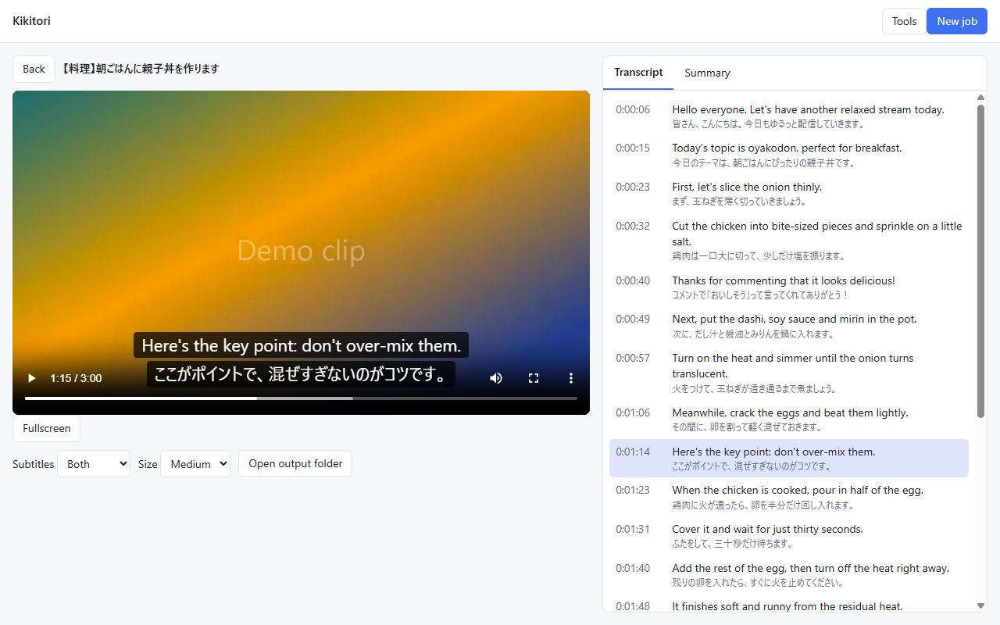
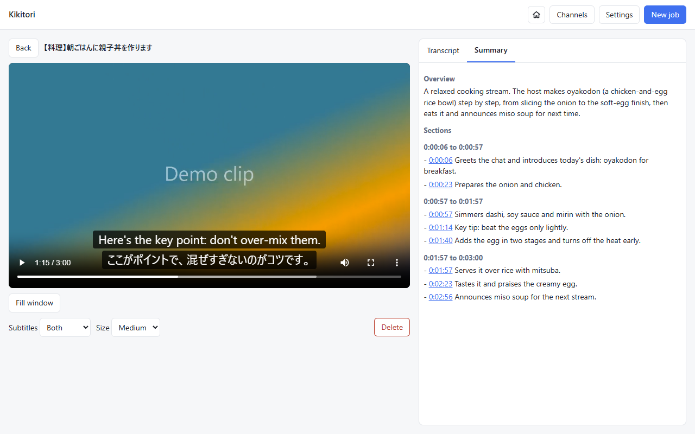
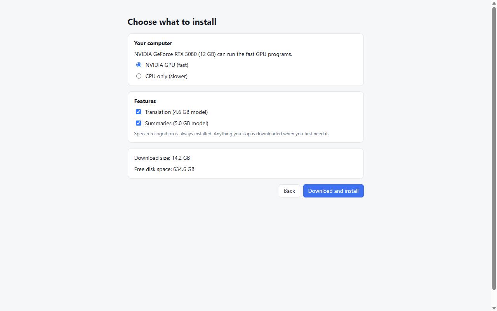

# Kikitori

*Understand Japanese videos, on your own computer.*

**Kikitori** (聞き取り) is Japanese for *catching what you hear*: picking the words out of speech as it goes by.
That is what this app does for Japanese YouTube videos. It listens to the audio, writes down what is said, translates it
to English and summarizes it with timestamps, then shows everything next to the video with subtitles that follow
along. It also works on audio and video files you already have.

- **Local and free:** speech recognition, translation and summaries all run on your own computer. Nothing you
  process is sent anywhere, and there is nothing to pay for.
- **Made for long videos:** streams and long recordings are handled in chunks and can be resumed.
- **Follows your channels:** add a YouTube channel and its new videos and finished live streams appear in a feed (checked while the app is open); one click sends any of them to a new job.
- **Set up in one click:** the first-run wizard checks your hardware (NVIDIA GPU or plain CPU) and downloads what it needs.



<table>
  <tr>
    <td width="50%"></td>
    <td width="50%"></td>
  </tr>
  <tr>
    <td align="center"><sub>A timestamped summary; every time jumps the video there.</sub></td>
    <td align="center"><sub>One-click first-run setup, matched to your hardware.</sub></td>
  </tr>
</table>

<sub>The screenshots use a fictional cooking stream and a generated clip, not a real video.</sub>

> Personal use only. Downloading videos may be against the terms of the site they come from, so follow them.
> Never publish downloaded media or transcripts, and never commit them to a repository.

## Install (Windows 10 or 11, 64-bit)

1. Download `Kikitori-Setup-<version>.exe` from the Releases page. Check it against `SHA256SUMS.txt`
   if you like (`Get-FileHash <file>` in PowerShell).
2. Run it. **Windows SmartScreen will warn** ("Windows protected your PC") because the installer is not signed:
   click **More info**, then **Run anyway**. No administrator rights are needed.
3. On first start the app looks at your computer and offers a one-click setup:
   - **NVIDIA GPU with 8 GB or more** (driver 551 or newer): about 14 GB of fast programs and models.
   - **Anything else (CPU only)**: about 4.5 GB. Transcription is slower than real time on this path.
   You can leave out Translation and Summaries; they are downloaded the first time you need them.
4. Paste a YouTube link (or drop an audio/video file) and press **Add to queue**.

Once installed, the app checks GitHub for a newer release a little after it starts and every few hours. It only tells
you (and **Tools > Check for updates** asks on demand): nothing is downloaded until you press **Download**, and
nothing is installed until you press **Restart and update**.

Downloaded tools and models live in `%APPDATA%\Kikitori`; subtitles and summaries are written to
`Documents\Kikitori`. Uninstalling keeps them, so delete the first folder yourself to free the space.
Antivirus programs sometimes flag yt-dlp or the model runtimes; they are downloaded from their publishers and
checked against pinned checksums.

## Development

```
pnpm install
pnpm setup:tools           # downloads the GPU set into resources/ (add --tier cpu for the CPU set)
pnpm dev:app               # run the desktop app
pnpm kikitori run <url> --translate --summarize
pnpm test && pnpm typecheck && pnpm lint
pnpm build:installer       # dist/Kikitori-Setup-<version>.exe
```

`BGT_USER_DATA=<folder>` runs the app against an empty profile (it then shows the first-run wizard).
Third-party components and licenses: `THIRD_PARTY_NOTICES.md`. Project license: MIT.
